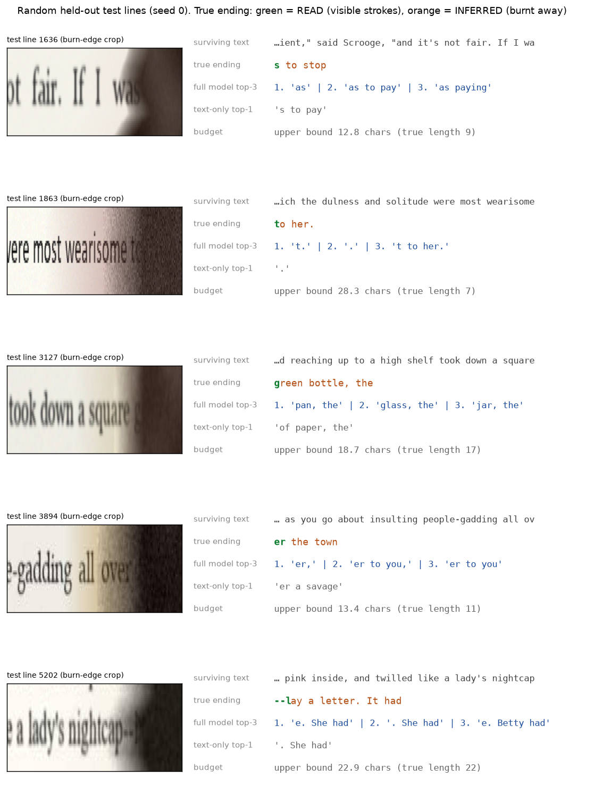
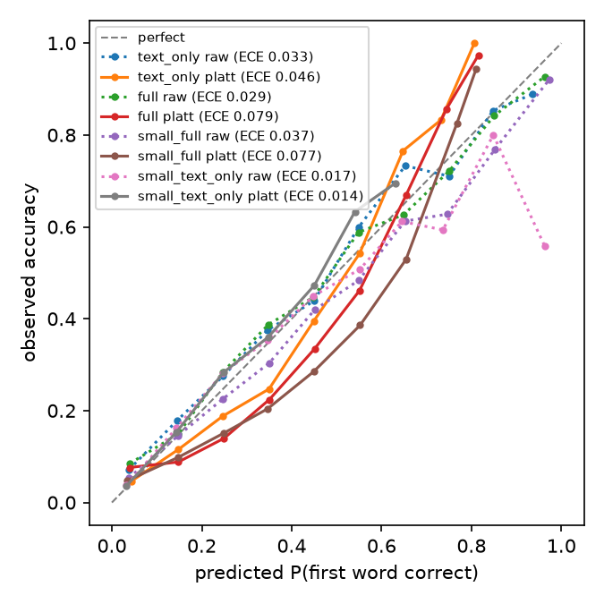
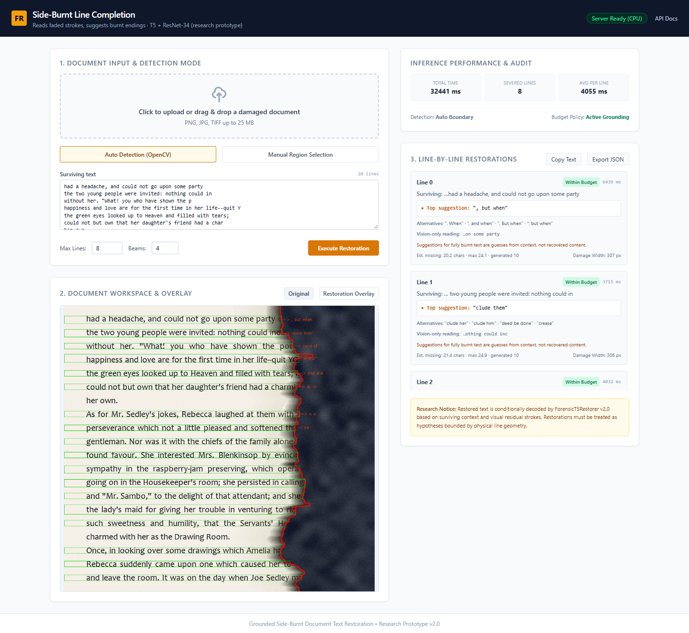

# Side-Burnt Text Lines: What the Image Can Read vs. What Context Can Only Suggest

[](https://www.python.org/)
[](https://pytorch.org/)
[](#8-limitations)

When a page burns along its side margin, every line loses its ending. Two very
different things are lost:

1. **A few characters at the burn edge that are faded but still have visible
   strokes.** Recovering these is a *recognition* problem, and the image can
   genuinely help.
2. **Everything past that edge, which is physically gone.** No model can
   *restore* this text. It can only *suggest* plausible completions from the
   surrounding lines, the way an epigrapher proposes readings for a gap in an
   inscription (cf. Pythia/Ithaca, Assael et al.).

This project builds a multimodal model for side-burnt text lines and evaluates
it with the two parts **kept separate**: READ (visible strokes) and INFERRED
(fully burnt). For the inferred part it reports ranked hypotheses, how likely
the model finds the true text, and how trustworthy its confidence is, not just a
single "restored" string scored by CER.



*Five randomly drawn held-out test lines (seed 0, not cherry-picked), full t5-base model vs. the
text-only baseline, decoded under the calibrated upper budget. The model often gets the READ
characters and the kind of continuation right (`'t to her.'` at rank 3, `', the'` endings) while the
burnt words themselves are guesses. Regenerate with `python scripts/make_readme_figures.py`.*

> **What this is not:** a forensic tool that recovers burnt text. All reported
> results are on synthetic burns of rendered book pages. A protocol for testing
> on genuinely burnt paper is included (§6) but has not been run yet.

---

## 1. Task

Each example is one severed line (v3 prompt):

```
previous: <line -2> || <line -1>          (visible starts of the two lines above)
line:     <visible prefix of this line><extra_id_0>
next:     <line +1> || <line +2>
length:   <estimated number of missing characters>
image:    128x256 crop centred on the burn edge (200 px left, 56 px right)
target:   the missing ending, e.g.  "ed to"
                                     ^^ READ (faint strokes in the crop)
                                       ^^^ INFERRED (fully burnt)
```

The prompt, crop, budget and target are produced by one module,
[`line_data.py`](line_data.py), which training, evaluation and inference all
share. The older v2 prompt (one line of context, no length) is still supported
so that earlier checkpoints load and evaluate unchanged.

## 2. Data (v3)

[`scripts/build_line_dataset.py --version v3`](scripts/build_line_dataset.py)

* **Text:** 57 public-domain Project Gutenberg books, **split by book**
  (train 47 / val 4 / test 6). No test book or author is seen in training.
* **Layout:** paragraphs with indented first lines, paragraph-final short
  lines (5% of severed lines), hyphenated line breaks (≈10%) and justified text.
  Rendered with 16 serif and sans fonts at 18–28 pt, with varied margins, line
  spacing, paper tone and ink.
* **Burn:** a jagged side boundary with a randomised appearance. The fade width
  (30–80 px) and the shape of the fade curve vary, and each burn adds a brown
  scorch halo, paper texture, noise, blur and JPEG compression. Lines are split
  at **character level**, with the cut where the fade reaches 50% opacity.
* **READ / INFERRED annotation:** a target character counts as READ if its
  centre lies before the point where the fade reaches 80% opacity. 90% of test
  lines have at least one READ character (mean ≈ 1.6); most of each target is
  INFERRED.
* **Context noise:** in training, half the samples get simulated OCR errors in
  their context lines (character confusions, deletions, insertions, up to 4%).
  This is because real context would come from OCR of damaged paper, not from
  ground truth.

| split | pages | severed lines |
|---|---|---|
| train | 5000 | 98,176 |
| val   | 200  | 3,961  |
| test  | 300  | 6,145  |

The earlier v2 set (35 books, clean layout, one fixed fade) is in `data/lines`
and its results are kept in §5.7 for comparison.

## 3. Model

`ForensicT5Restorer` in [`model.py`](model.py):

| part | role |
|---|---|
| t5-small (60M) or t5-base (220M) encoder-decoder | language prior, span infilling |
| multi-scale ResNet-34 → **128 visual tokens** (8×16 grid; layer4 upsampled and fused with layer3) | stroke evidence at the burn edge |
| **residual gated cross-attention** (Flamingo-style) | text tokens attend to visual tokens |
| **CTC reading head** on stride-8 ResNet features (BiGRU, 95 printable ASCII characters + blank) | vision-only transcription of the text visible in the crop |
| contrastive stroke aligner | InfoNCE between ghost-zone features and READ characters only |
| cut estimator (small CNN, separate from the restorer) | predicts where the legible text ends, for the character budget |
| physical budget logits processor | never lets an ending exceed the calibrated upper budget |

**Design choices**

* **Fusion.** Pretrained T5 embeddings pass through **unchanged**. Visual
  evidence is *added* through tanh gates that start at zero, and visual tokens
  are rescaled to T5's embedding RMS. At initialisation the model is exactly
  pretrained T5, so the image can only add information. The first version
  (`fusion_style="legacy"`, still loadable) normalised and shrank the text
  embeddings, which damaged the language prior and cancelled the visual gain.
* **Finer grid.** The coarse 4×8 grid gave each visual token ≈32 px of width,
  about two characters. The 8×16 grid gives about one character per token.
* **Reading head.** Trained with CTC on the text actually visible in the crop
  (`lambda_read` = 0.3). This forces the vision encoder to learn real glyph
  recognition. It also gives the UI a vision-only reading that is independent
  of the language model.
* **Contrastive loss on READ characters only.** Aligning image features with
  text that is not in the image would train the encoder to hallucinate.
* **Length hint.** The estimated number of missing characters goes into the
  prompt, so the model can plan for the gap, not only be cut off by the budget
  processor.
* **Calibrated upper budget.** The number of missing characters is estimated
  from geometry: the gap from the cut to the right text edge, divided by the
  prefix's average glyph width. This is a *median-type* estimate. The glyph
  widths of the missing text are unknown, and justified lines run to the
  margin, so 30% of true v3 endings are longer than it. The old decoder still
  penalised anything past estimate + 2 characters. That rule cut off 7.6% of the
  *correct* endings, yet only forced a stop 7 characters past the estimate.
  The fix ([`scripts/train_cut_estimator.py`](scripts/train_cut_estimator.py)):
  1. A small CNN predicts the cut position from the crop. Its error is 0.96 px,
     against 7.3 px for the old fixed 27 px offset, and the resulting estimate is
     as accurate as one using the true cut.
  2. The upper bound `1.139 × estimate + 1` is calibrated on validation so that
     99% of true endings fit (98.8% on test).
  3. Decoding enforces it exactly. Each step masks every token that would push
     the ending past the bound, and nothing may follow the span-closing sentinel.

  The prompt's length hint keeps the formula the checkpoints were trained with.
  Retraining with the calibrated estimate in the prompt barely changed the
  results (§5.6).

**Training** ([`train.py`](train.py)) has two stages: stage 1 freezes T5 for one
epoch; stage 2 fine-tunes everything with per-group learning rates (fusion gates
10×). It uses bf16 autocast, batch 16, and early stopping on validation CER.
t5-small runs for 5 epochs (≈21 min/epoch on one consumer GPU). t5-base runs for 3 epochs with
gradient checkpointing (4.6 GiB peak). The text-only baselines use the same data, prompts and
schedule, with no image and no reading head.

## 4. Evaluation protocol

[`scripts/evaluate_lines.py`](scripts/evaluate_lines.py), run on all 6,145 v3
test lines. Every system uses the same beam search (k = 5) with the budget
processor on, and the prompt style it was trained with.

| metric | measures |
|---|---|
| **READ acc** | top-1 starts with the exact READ characters (lines with ≥1 READ char) |
| **INFERRED CER** | CER on the rest (positional approximation) |
| CER / EM | whole target, single reference |
| **EM@5, 1st-word@5** | is the truth among the 5 ranked hypotheses? |
| **bits/char** | −log₂ p(true target) per character, teacher-forced; lower = the model finds the truth more likely |
| **CTC read acc / CER** | vision-only reading head vs. the text visible in the crop |
| **AUROC, top-25% acc** | does the model's confidence (P(first word)) separate right from wrong first words? |
| **ECE / Brier** | calibration of that confidence; raw, and after Platt scaling fitted on 1,000 validation lines |
| budget viol. | top-1 longer than the calibrated upper budget (98.8% of true endings fit it) |
| overlong | top-1 more than 3 characters longer than the true ending |

Systems: empty prediction, zero-shot t5-small, fine-tuned **text-only**, the
**full** model, the full model with a **blank** or **mismatched** image
(ablations), the full model with **OCR-noised context** (3% character error
rate, fixed seed), and the v2 model on v3 data. Rows marked *old budget* decode
with the previous rule (point estimate, soft penalty). This gives a direct
comparison, and the image ablations use it too: given a blank image the model
is out of distribution and would otherwise ramble until it hits the hard
ceiling. The significance tests are
paired bootstrap tests (B = 1000) on the same lines.

## 5. Results (held-out test books, 6,145 lines)

Full output: [`results/line_eval_v3.json`](results/line_eval_v3.json)
(t5-small) and [`results/line_eval_v3_base.json`](results/line_eval_v3_base.json)
(t5-base). Reliability plots are saved next to each file.

### 5.1 Main table

| system | READ acc ↑ | READ @5 ↑ | INFERRED CER ↓ | CER ↓ | EM ↑ | EM@5 ↑ | 1st word ↑ | 1st word @5 ↑ | bits/char ↓ | budget viol. ↓ | overlong ↓ |
|---|---|---|---|---|---|---|---|---|---|---|---|
| empty | 0 | 0 | 1.000 | 1.000 | 0 | 0 | 0 | 0 | – | 0 | 0 |
| zero-shot t5-small | 0.113 | 0.120 | 1.040 | 1.015 | 0.001 | 0.002 | 0.060 | 0.065 | 4.27 | 0 | 44.8% |
| v2 full, on v3 data | 0.378 | 0.496 | 0.822 | 0.767 | 0.034 | 0.058 | 0.176 | 0.262 | 2.06 | 0 | 1.5% |
| text-only, t5-small | 0.232 | 0.357 | 0.815 | 0.775 | 0.037 | 0.063 | 0.166 | 0.250 | 1.85 | 0 | 1.8% |
| **full, t5-small** | **0.700** | **0.812** | 0.768 | 0.699 | 0.069 | 0.118 | 0.401 | 0.523 | 1.57 | 0 | 1.9% |
| text-only, t5-base | 0.361 | 0.518 | 0.741 | 0.702 | 0.078 | 0.132 | 0.293 | 0.414 | 1.44 | 0 | 2.7% |
| **full, t5-base** | 0.660 | 0.783 | **0.717** | **0.656** | **0.103** | **0.174** | **0.418** | **0.553** | **1.31** | 0 | 2.4% |

### 5.2 Budget fix: old rule vs calibrated upper bound

Same checkpoints, same test lines; only the decoding budget differs.

| system | budget | CER ↓ | INFERRED CER ↓ | EM ↑ | READ acc | overlong ↓ | viol. (upper bound) ↓ |
|---|---|---|---|---|---|---|---|
| text-only, t5-small | old rule | 0.810 | 0.853 | 0.029 | 0.231 | 8.7% | 8.4% |
| | **upper bound** | **0.775** | **0.815** | **0.037** | 0.232 | **1.8%** | **0%** |
| full, t5-small | old rule | 0.755 | 0.827 | 0.048 | 0.701 | 12.2% | 11.7% |
| | **upper bound** | **0.699** | **0.768** | **0.069** | 0.700 | **1.9%** | **0%** |
| text-only, t5-base | old rule | 0.795 | 0.841 | 0.052 | 0.349 | 20.4% | 20.1% |
| | **upper bound** | **0.702** | **0.741** | **0.078** | 0.361 | **2.7%** | **0%** |
| full, t5-base | old rule | 0.744 | 0.810 | 0.068 | 0.653 | 18.7% | 18.3% |
| | **upper bound** | **0.656** | **0.717** | **0.103** | 0.660 | **2.4%** | **0%** |

All CER and INFERRED CER differences are p < 0.001 (paired bootstrap). The
bits/char numbers are identical because they are computed teacher-forced, so
they don't depend on decoding. On a 300-line subset (t5-base full), removing the
"stop after the span-closing sentinel" rule leaves the gain intact (CER 0.654
vs 0.728). So the gain comes from the bound itself.

### 5.3 Ablations and robustness

| system | READ acc | INFERRED CER | CER | bits/char | CTC read acc / CER |
|---|---|---|---|---|---|
| full, t5-small (old budget) | 0.701 | 0.827 | 0.755 | 1.57 | 0.707 / 0.029 |
| … blank image (old budget) | 0.159 | 0.823 | 0.796 | 3.06 | 0 / 1.0 |
| … mismatched image (old budget) | 0.072 | 0.873 | 0.846 | 2.26 | 0.032 / 0.856 |
| full, t5-small | 0.700 | 0.768 | 0.699 | 1.57 | 0.707 / 0.029 |
| … OCR-noised context | 0.696 | 0.790 | 0.720 | 1.64 | (unchanged) |
| full, t5-base (old budget) | 0.653 | 0.810 | 0.744 | 1.31 | 0.651 / 0.041 |
| … blank image (old budget) | 0.277 | 0.779 | 0.748 | 2.15 | 0 / 1.0 |
| full, t5-base | 0.660 | 0.717 | 0.656 | 1.31 | 0.651 / 0.041 |
| … OCR-noised context | 0.644 | 0.749 | 0.686 | 1.41 | (unchanged) |

Paired tests (negative = first system better):

| comparison | Δ CER | Δ READ error | Δ INFERRED CER | Δ bits/char |
|---|---|---|---|---|
| small full vs small text-only | −0.076*** | −0.468*** | −0.047*** | −0.279*** |
| base full vs base text-only | −0.046*** | −0.298*** | −0.024*** | −0.128*** |
| base full vs small full | −0.043*** | +0.040 (small better) | −0.051*** | −0.255*** |
| small full vs v2 full (on v3 data) | −0.068*** | −0.322*** | −0.054*** | −0.491*** |
| small full vs blank image (both old budget) | −0.041*** | −0.542*** | +0.004 (n.s.) | −1.49*** |
| small full, noisy vs clean context | +0.021 | +0.004 | +0.022 | +0.071 |

\*\*\* p < 0.001

**Confidence and calibration**

| system | AUROC ↑ | 1st-word acc, most confident 25% ↑ | ECE raw ↓ | ECE after Platt |
|---|---|---|---|---|
| text-only, t5-small | 0.841 | 0.441 | 0.017 | 0.014 |
| **full, t5-small** | **0.896** | **0.897** | 0.037 | 0.077 |
| text-only, t5-base | 0.840 | 0.696 | 0.033 | 0.046 |
| full, t5-base | 0.866 | 0.876 | 0.029 | 0.079 |



*Reliability of the first-word confidence on the test books (t5-base, and t5-small as `small_*`): predicted probability vs.
observed accuracy, raw and after Platt scaling.*

Results from before the budget fix are kept in
[`results/pre_budget_fix/`](results/pre_budget_fix/).

### 5.4 What the numbers say

1. **The image reads the visible characters.** With t5-small, READ accuracy
   rises from 23% (text-only) to 70%. A blank image drops it to 16% and a
   mismatched image to 7%, so the model uses *this line's* strokes. The
   vision-only reading head transcribes the visible text with 0.03 CER; with a
   mismatched image it falls to chance.
2. **The image does not recover the burnt part.** With the image blanked
   (both decoded with the old budget), INFERRED CER stays the same for
   t5-small (0.823 vs 0.827, n.s.) and gets *better* for t5-base (0.779 vs
   0.810). This is partly because blank-image outputs are shorter, which the
   positional INFERRED CER rewards. The INFERRED gain of full over text-only
   comes from correctly read word starts giving better continuations, not from
   seeing burnt text.
3. **The budget fix was the largest single gain for the guessing part.** With a
   calibrated upper bound enforced exactly, overlong endings fall from 9–20% to
   about 2%, and INFERRED CER improves by 0.04–0.10 for every model (§5.2). The old
   rule was wrong in both directions. It penalised 7.6% of *correct* endings,
   but only forced a stop 7 characters past its estimate, so models ran long.
   The gain is bigger for t5-base, which tends to write longer endings.
4. **A larger language model helps the guessing.** t5-base improves bits/char
   (1.57 → 1.31), EM@5 (0.118 → 0.174) and INFERRED CER (0.768 → 0.717) over
   t5-small. With only 3 epochs, its vision side is less trained: its READ
   accuracy (0.66) and CTC reading (0.65) are below t5-small's (0.70 / 0.71).
5. **Confidence is useful.** When the t5-small full model is in its most
   confident quarter, the first word is right 90% of the time (text-only: 44%),
   with AUROC 0.90. In v2 the AUROC was only 0.69. A UI can show confident
   suggestions and flag the rest.
6. **Calibration: raw is better than Platt here.** The raw P(first word) is
   already reasonably calibrated (ECE 0.03–0.04, slightly overconfident in the
   middle). Platt scaling fitted on the validation books made it *worse* on the
   test books. The validation set is only 4 books, and the confidence–accuracy
   relation shifts between books. Report the raw confidence.
7. **Robust to noisy context.** 3% OCR errors in the context lines cost ≈2–3
   CER points, and the gap between full and text-only stays the same.
8. **v3 data is harder.** The v2 model's READ accuracy falls from 0.68 on v2
   data to 0.38 on v3. The variable fade, halo and layout make it a stricter
   test, and the v3 model beats v2 on it on every axis.
9. **Layout.** For the t5-small full model, hyphenated lines are slightly easier
   (CER 0.68 vs 0.70) and paragraph-final lines slightly harder (0.71 vs 0.70).

### 5.5 External baseline: off-the-shelf OCR + a larger LLM

To check that the gains are not an artefact of comparing only our own models, a
baseline was built from pretrained parts with no training on this task
(`scripts/baseline_ocr_llm.py`).

**How the baseline works**
- **OCR:** TrOCR base stage 1 reads the crop. It had the lowest CER on the
  visible text of 150 test crops: 0.09, against 0.29 for Tesseract and 0.95 for
  trocr-large-printed.
- **READ guess:** whatever the OCR reads past the known prefix.
- **Completion:** Qwen2.5-1.5B (about 7× t5-base) continues the context with
  10 beams. Candidates are re-ranked by the likelihood of the next line.
- **Length:** every candidate is cut to the same calibrated upper bound.

Full output: [`results/line_eval_baseline.json`](results/line_eval_baseline.json).

| system | READ acc | INFERRED CER | CER | EM | 1st word | 1st word @5 |
|---|---|---|---|---|---|---|
| LLM only (Qwen2.5-1.5B) | 0.127 | 0.988 | 0.969 | 0.004 | 0.076 | 0.085 |
| OCR + LLM (TrOCR + Qwen) | 0.657 | 0.948 | 0.876 | 0.014 | 0.386 | 0.397 |
| ours, text-only (t5-base) | 0.361 | 0.741 | 0.702 | 0.078 | 0.293 | 0.414 |
| ours, full (t5-base) | **0.660** | **0.717** | **0.656** | **0.103** | **0.418** | **0.553** |

**Reading the faded characters**
- With OCR, the baseline reads the faded characters as well as our model does:
  READ 0.657 vs 0.660, p = 0.38.
- So this part of the task really is reading, and a strong OCR model can do it.

**Guessing the burnt text**
- Our model is much better at guessing the burnt text (p < 0.001 throughout):
  - INFERRED CER: 0.717 vs 0.948;
  - overall CER: 0.656 vs 0.876;
  - exact matches: 10.3% vs 1.4%.
- Without task training, the LLM tends to fill all the available space. 37.8% of
  its endings are longer than the truth, against 2.4% for ours.

**Text-only vs the LLM**
- Even the text-only t5-base beats the LLM-only baseline on every measure.
- Qwen may have seen Project Gutenberg text in pre-training, which would only
  favour the baseline.

### 5.6 Tried: the calibrated estimate in the prompt (v3e)

The checkpoints above were trained with the old length-hint formula in the
prompt. A second round (`--prompt_style v3e`) retrained all four models with the
cut-estimator's estimate in the prompt instead, keeping the same data, schedule
and upper bound. Full output:
[`results/line_eval_v3e.json`](results/line_eval_v3e.json) and
[`results/line_eval_v3e_base.json`](results/line_eval_v3e_base.json).

| system | prompt | READ acc | INFERRED CER | CER | EM | bits/char |
|---|---|---|---|---|---|---|
| text-only, t5-small | v3 | **0.232** | **0.815** | **0.775** | **0.037** | **1.85** |
| | v3e | 0.177 | 0.828 | 0.789 | 0.033 | 1.93 |
| full, t5-small | v3 | 0.700 | 0.768 | 0.699 | 0.069 | 1.57 |
| | v3e | **0.707** | **0.760** | **0.692** | 0.069 | 1.57 |
| text-only, t5-base | v3 | 0.361 | 0.741 | 0.702 | 0.078 | 1.44 |
| | v3e | **0.391** | **0.733** | **0.694** | **0.083** | **1.41** |
| full, t5-base | v3 | 0.660 | 0.717 | 0.656 | 0.103 | 1.31 |
| | v3e | **0.672** | 0.716 | 0.655 | **0.105** | 1.31 |

For the full models the change is small: −0.008 CER with t5-small (p < 0.001)
and −0.002 with t5-base (p = 0.17, not significant). The text-only models move
in opposite directions (worse with t5-small, better with t5-base). The prompt's
length hint is not where the remaining error is, so the v3 checkpoints stay the
main configuration. The upper bound alone already removes most overlong endings.

### 5.7 Earlier results (v2 data, t5-small)

On the v2 test set (5,854 lines, clean layout, fixed fade; see
[`results/line_eval.json`](results/line_eval.json)), the v2 full model reached
READ acc 0.677, INFERRED CER 0.831, CER 0.744, EM@5 0.141 and bits/char 1.56,
compared with 0.184 / 0.856 / 0.809 / 0.065 / 1.91 for text-only. The legacy-fusion v1
model only tied text-only on CER (0.807); see
[`results/line_eval_v1_legacy_fusion.json`](results/line_eval_v1_legacy_fusion.json).

## 6. Real-damage test (protocol, not yet run)

Synthetic burns are the main threat to validity, so the repository includes a
small real test:

```bash
# 1. render 4 pages from held-out TEST books at print resolution + annotation template
python scripts/make_real_test_pages.py --n_pages 4 --out real_test
# 2. print real_test/page_*.png (fit to page width)
# 3. scorch the RIGHT edge of each sheet so line endings are lost and a band of
#    partly legible ink remains. Do this outdoors or over a sink, with water at
#    hand, and never leave burning paper unattended.
# 4. photograph or scan each sheet flat; save as real_test/photo_<n>.jpg
# 5. in real_test/annotations.json, for each damaged line fill in
#      "legible": text readable with confidence, "faint": partly visible chars after it
# 6. evaluate
python scripts/evaluate_real.py --dir real_test \
    --ckpt checkpoints/v3_full/best_checkpoint.pt \
    --text_only_ckpt checkpoints/v3_text_only/best_checkpoint.pt
```

The ground truth is known because we printed it. The script rescales each photo
so its line pitch matches training scale, finds the burn edge with the burn
detector, and reports READ accuracy, INFERRED CER, CER, EM, EM@5 and the CTC
reading. The results go to `results/real_eval.json`. The pipeline was checked
end to end on a software-burnt, downscaled and blurred page. No real photos have
been evaluated yet.

## 7. Usage

```bash
# environment (Windows example; CUDA wheel for torch, see requirements.txt)
python -m venv .venv && .venv\Scripts\activate
pip install -r requirements.txt

# 1. data (downloads Gutenberg text, renders and burns pages; ~10 GB for v3)
python scripts/build_line_dataset.py --version v3 --train_pages 5000 --val_pages 200 \
    --test_pages 300 --out_dir data/lines_v3

# 2. train (t5-small; add --text_model t5-base --gradient_checkpointing for t5-base)
python train.py --data_dir data/lines_v3 --epochs 5 --warmup_epochs 1 --batch_size 16 \
    --val_limit 800 --patience 2 --ckpt_dir checkpoints/v3_full
python train.py --data_dir data/lines_v3 --epochs 5 --batch_size 16 --val_limit 800 \
    --patience 2 --ckpt_dir checkpoints/v3_text_only --text_only

# 3. evaluate (+ calibration and OCR-noise variants)
python scripts/evaluate_lines.py --data_dir data/lines_v3 \
    --full_ckpt checkpoints/v3_full/best_checkpoint.pt \
    --text_only_ckpt checkpoints/v3_text_only/best_checkpoint.pt \
    --calib_n 1000 --context_noise 0.03 --out results/line_eval_v3.json
# (needs checkpoints/cut_estimator.pt for the calibrated upper budget:)
python scripts/train_cut_estimator.py --data_dir data/lines_v3 --out checkpoints/cut_estimator.pt

# tests
python -m pytest -q

# demo API + web UI (http://127.0.0.1:8000/): upload a page, paste its surviving text
# (one printed line per line) -> top suggestion, alternatives, vision-only reading.
# Serves checkpoints/v3_base_full by default; set BURN_CKPT to use another checkpoint.
python -m api.main
# CLI on a page image
python scripts/restore_document.py --help
```



*Web demo (t5-base, CPU) on a synthetic burnt page from a held-out test book. The text in the
paste box is the page's printed text up to the burn, taken from the generator (i.e. a perfect
transcription, not OCR); the model never saw this book in training.*

[`scripts/run_v3.cmd`](scripts/run_v3.cmd) runs both rounds (t5-small and t5-base,
full and text-only, plus evaluation) unattended on Windows;
[`scripts/run_budget_eval.cmd`](scripts/run_budget_eval.cmd) re-evaluates both rounds with the calibrated upper budget.
[`scripts/run_reframe.cmd`](scripts/run_reframe.cmd) reproduces the v2 results.

## 8. Limitations

* **Synthetic burns only.** The v3 burns are randomised (fade, halo, texture,
  blur, JPEG), but they still come from our own simulator. Real charring
  (curling, edge loss, carbonised ink that shows in infrared) can look
  different. The §6 protocol is the missing experiment.
* **Inferred text is a guess.** CER around 0.8 on the inferred part mostly
  reflects that the text is unrecoverable, not a model bug. Outputs should be
  presented as ranked suggestions with confidence, never as the document's
  content. The UI says so.
* **The page demo has no OCR.** The model needs the surviving text of the line and
  its neighbours, which the user pastes into the UI (or passes as `page_text` /
  `page_transcripts`). Without it the model sees only the crop and its suggestions are poor.
  Pasted lines are paired with detected text lines top to bottom; the UI warns if the counts
  differ. On synthetic pages the detector finds 99.5% of severed lines with the burn edge
  ≈5 px from the truth, and its line count matches the printed lines on 117/120 pages
  (`scripts/validate_burn_detector.py`).
* **Simulated OCR noise.** Context noise is a character-level model of OCR errors,
  not the output of a real OCR engine on damaged paper.
* **Length estimation.** The upper budget is calibrated for 99% coverage on
  synthetic pages. About 1.2% of true endings are still longer than it and get
  truncated. The cut estimator has only seen simulated burns, and the bound
  assumes symmetric page margins.
* **Calibration across books.** Platt scaling fitted on 4 validation books did
  not transfer; a larger, more varied calibration set would be needed.
* **t5-base under-trained.** t5-base got 3 epochs because of compute limits.
  Its weaker READ accuracy suggests the vision side needs longer training.

The documents in [`archive/`](archive/) (the old `docs/`, `report.*`,
`PROGRESS_REPORT.md`, …) describe an earlier 6-page prototype whose checkpoint
was essentially untrained. **Their numbers are superseded by §5.**

## 9. Repository map

```
line_data.py               single preprocessing contract (prompts v2/v3, layout, burns, crop, budget, READ split, OCR noise)
model.py                   ForensicT5Restorer, ResidualGatedFusion, CTCReadingHead, CutOffsetRegressor, budget processor
dataset.py                 LineCacheDataset (memmap crops) + collator
train.py                   two-stage training
scripts/build_line_dataset.py   data generation (--version v2|v3)
scripts/evaluate_lines.py       held-out evaluation, ablations, calibration, bootstrap tests
scripts/train_cut_estimator.py  cut-position CNN + calibrated upper character budget
scripts/make_real_test_pages.py, evaluate_real.py   real-damage protocol
scripts/make_readme_figures.py  README example figure; scripts/validate_burn_detector.py  page detector vs ground truth
scripts/annotate_visibility.py  READ annotation for the v2 cache
inference/                 page-level engine: burn detector, budget estimator
api/                       FastAPI demo + static web UI
tests/                     pytest suite
archive/                   superseded prototype docs, reports and scripts (not maintained)
results/                   line_eval_v3*.json (current), pre_budget_fix/, line_eval.json (v2), line_eval_v1_legacy_fusion.json
```

License: code under the [MIT License](LICENSE). The training text comes from public-domain
Project Gutenberg books; the rendered pages are synthetic.
